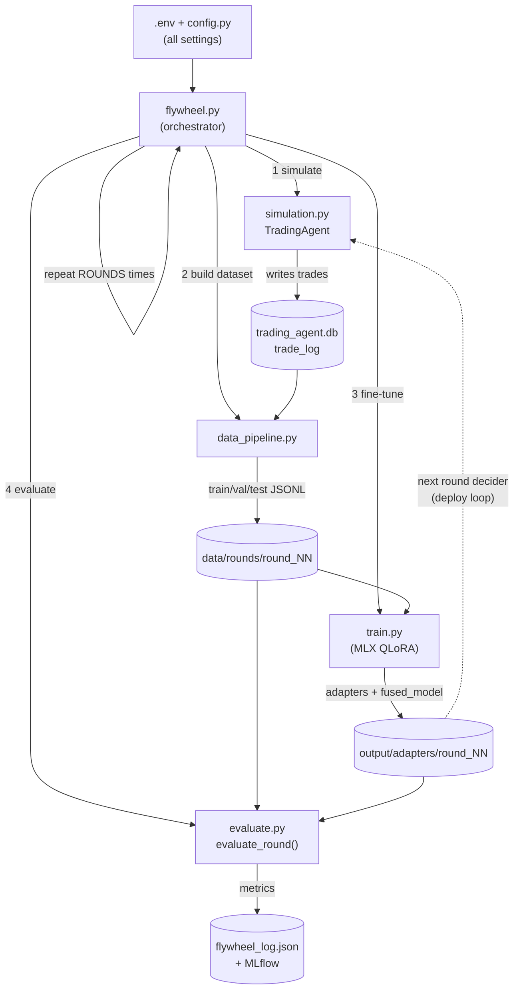
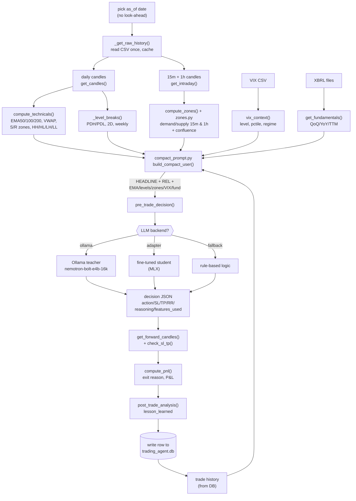
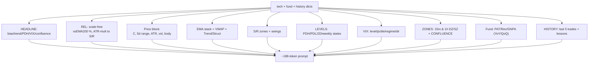
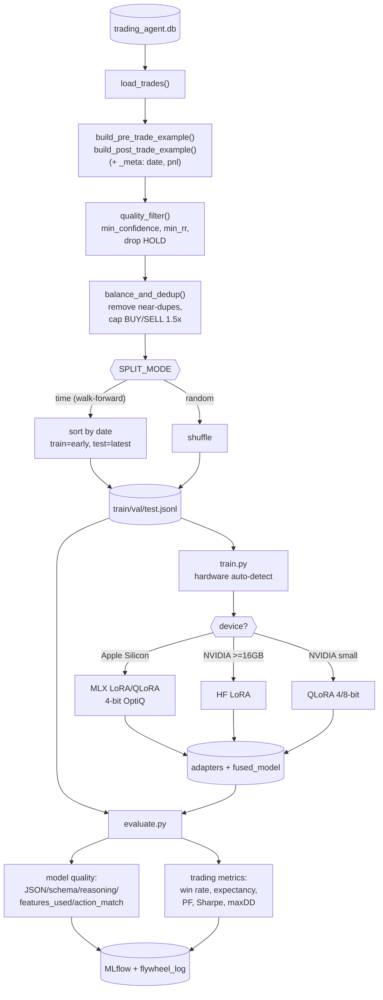
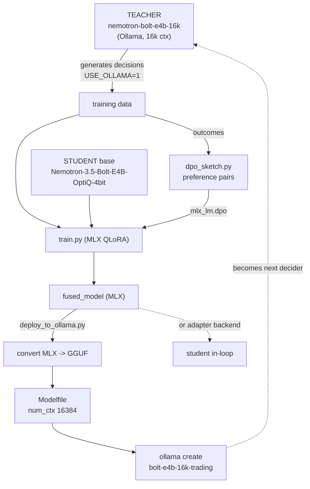

# Architecture & Flow — llm_finetune

Mermaid diagrams of the trading-agent LLM fine-tuning pipeline. All top-down.

---

## 1. The flywheel loop (macro)

---

## 2. Inside one simulation episode (micro)

---

## 3. Prompt assembly (compact_prompt.py)

---

## 4. Dataset build -> training -> evaluation

---

## 5. Teacher / student and the deploy loop

